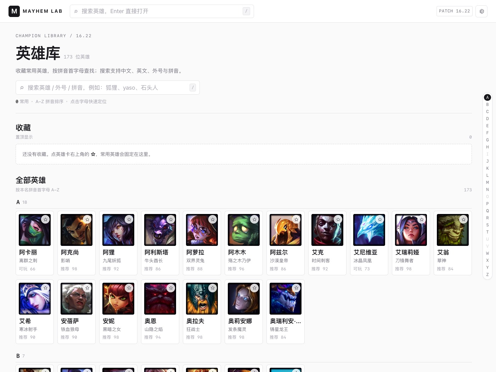
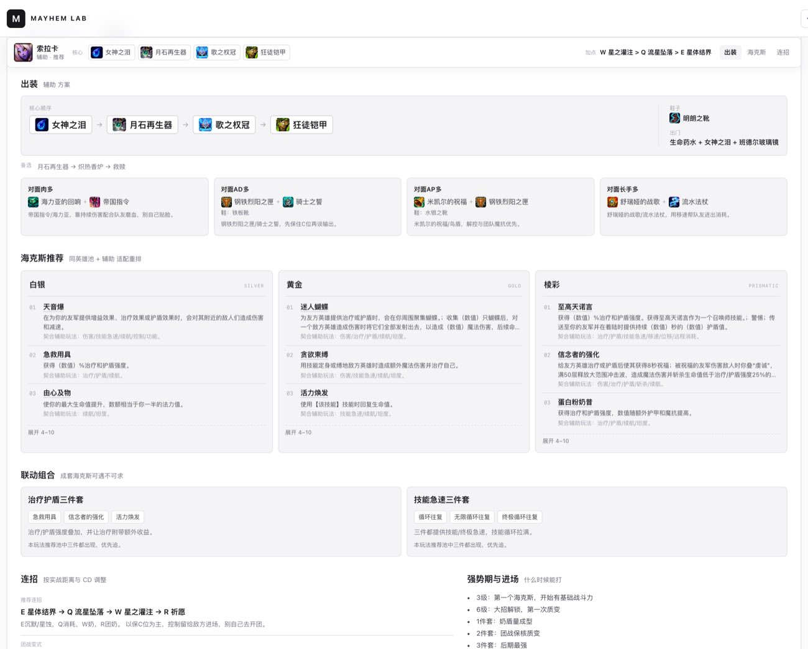

# lol-aram-mayhem · 海克斯大乱斗助手

英雄联盟「海克斯大乱斗」（ARAM: Mayhem）的**离线查询工具**，给 AI Agent 用，也带一个网页版。

- 🦸 **173 位英雄** 的白银 / 黄金 / 棱彩海克斯前 10、联动组合、连招、强势期
- 🛒 **出装**：嚎哭深渊守护者出门 + 核心顺序 + 对面肉多 / AD 多 / AP 多 / 长手多怎么换（肉装固定心之钢起手）
- 🎯 **玩法筛选**：AD / AP / 肉 / 消耗 / 辅助；肉只对战士坦克开放，辅助只对辅助英雄开放
- 📦 **数据来自本地 SQLite**（当前 Patch 16.22），不靠模型记忆，版本可存档
- 🖥️ **网页版**：顶栏全局搜索（`/`、`⌘K`）、收藏、玩法标签切换、设置抽屉调字号，纯静态无后端



---

## 目录结构

```
lol-aram-mayhem/
├── SKILL.md              # Agent 使用说明（工作流 + 硬性约束）
├── README.md             # 本文件：安装 / 使用 / 维护
├── install.ps1           # Windows 一键自检安装
├── install.sh            # macOS / Linux 一键自检安装
├── data/
│   ├── current.json      # 当前版本指针
│   └── 16.22.1/lol.db    # 该版本 SQLite（英雄/装备/海克斯/OP.GG 排序）
├── scripts/
│   ├── lol.py            # 命令行查询入口（resolve / report / augments / search）
│   ├── variants.py       # 玩法方案生成（AD/AP/肉/消耗/辅助）
│   ├── export_web.py     # 导出网页数据 web/public/data/lol.json
│   ├── update.py         # 抓新版本 → 建新库 → 校验 → 切指针
│   ├── build_db.py / fetch_sources.py / parse_pages.py
│   └── vendor/pypinyin   # 内置拼音库，无需联网安装
└── web/                  # Vue 3 + Vite 网页
```

---

## 环境要求

| 用途 | 需要 |
| --- | --- |
| 命令行查询 | Python **3.10+**（3.11 / 3.12 均可），只用标准库 |
| 网页版 | Node.js **20+**、npm |
| 安装 | Git |

Windows 上命令里的 `python3` 一律换成 `python`（或 `py -3`）。

---

## 安装

### Windows（PowerShell）

```powershell
# 1. 放到你和 agent 约定的 skills 目录（以 .dsh 为例）
New-Item -ItemType Directory -Force "$env:USERPROFILE\.dsh\skills" | Out-Null
git clone https://github.com/jiuxianzai/lol-aram-mayhem.git "$env:USERPROFILE\.dsh\skills\lol-aram-mayhem"
cd "$env:USERPROFILE\.dsh\skills\lol-aram-mayhem"

# 2. 自检（检查 Python、跑一次 status）
powershell -ExecutionPolicy Bypass -File .\install.ps1

# 3. 想装网页版就加 -Web
powershell -ExecutionPolicy Bypass -File .\install.ps1 -Web
```

> 执行策略报错时，用上面这种 `-ExecutionPolicy Bypass -File` 的写法即可，不需要改系统设置。

> 仓库是**私有**的，clone 前需要先登录：`gh auth login`（推荐，装好后用 `gh repo clone jiuxianzai/lol-aram-mayhem`），或者把 Personal Access Token 存进 Git 凭据管理器。

### macOS / Linux

```bash
mkdir -p ~/.dsh/skills
git clone https://github.com/jiuxianzai/lol-aram-mayhem.git ~/.dsh/skills/lol-aram-mayhem
cd ~/.dsh/skills/lol-aram-mayhem
chmod +x install.sh && ./install.sh        # 加 --web 顺带装网页依赖
```

### 手动验证

```bash
python scripts/lol.py status
python scripts/lol.py resolve "狐狸"
```

`status` 会打印当前 patch、DDragon 版本、英雄/海克斯数量和数据库路径。

---

## 让 Agent 用起来

`SKILL.md` 就是这个技能的说明书，放在 skills 目录后，Agent 会自动读取；不同客户端放法：

| 客户端 | 放置位置 |
| --- | --- |
| Claude Code | `~/.claude/skills/lol-aram-mayhem/`（Windows：`%USERPROFILE%\.claude\skills\...`） |
| DSH / Paseo | `~/.dsh/skills/lol-aram-mayhem/` |
| Codex / 其他 | 任意目录，把路径写进它的系统提示或项目说明即可 |

直接对 Agent 说：

```
用 lol-aram-mayhem 技能查一下阿狸这版本玩 AP 怎么出装
石头人海克斯大乱斗怎么玩，对面肉多的时候换什么
索拉卡辅助出什么，海克斯优先级
```

Agent 的固定流程（SKILL.md 里写死了）：**解析英雄 → 判断歧义 → 让用户选玩法 → 按玩法输出六段内容**，所有海克斯/装备名都从数据库取，不允许编造。


---

## 命令行用法

```bash
python scripts/lol.py status                    # 版本与数据量
python scripts/lol.py list                      # 全部英雄
python scripts/lol.py resolve "yaso"            # 英雄解析（中文/英文/拼音/外号）
python scripts/lol.py report "Ahri"             # 基础报告（海克斯前 10）
python scripts/lol.py report "Ahri" --styles all # 全部玩法方案
python scripts/lol.py report "Soraka" --styles support
python scripts/lol.py augments "Garen" --tier Gold
python scripts/lol.py search "魔法飞弹"           # 搜海克斯/装备
```

`--styles` 可选 `ad,ap,tank,poke,support` 或 `all`；不在该英雄开放范围内的玩法会被自动过滤（肉只给战士/坦克，辅助只给辅助英雄）。

---

## 网页版

### Windows：双击启动（推荐）

直接双击仓库根目录的 **`start-web.bat`**：

1. 第一次运行会自动 `npm install`（约 1-2 分钟，只需一次）
2. 起好服务后自动打开浏览器 `http://127.0.0.1:5178/`
3. **关掉那个黑窗口 = 停止服务**，不用再手动关

细节：

- 如果端口 5178 被上一次没退干净的进程占着，启动时会自动结束它
- 提示 `没找到 Node.js` 就装一个：`winget install --id OpenJS.NodeJS.LTS -e`
- 想换端口：在命令行执行 `start-web.bat -Port 5180`（双击时默认 5178）
- 启动窗口里能看到 Vite 日志和报错，出问题先看那里

底层是 `start-web.ps1`，`.bat` 只是负责双击不被执行策略拦住，不需要改系统设置。

### macOS / Linux（或手动启动）

```bash
cd web
npm install
npm run dev          # http://127.0.0.1:5178
```

生产构建：

```bash
npm run build        # 产物在 web/dist/，交给任意静态服务器
npm run preview      # 本地预览构建产物
```

网页数据是静态 JSON（`web/public/data/lol.json`，约 8 MB），不需要后端；更新数据库后重新导出：

```bash
python scripts/export_web.py
```



---

## 更新到新版本

```bash
python scripts/update.py                 # 抓最新版本，建 data/<新版本>/lol.db，校验后切指针
python scripts/update.py --version 16.23.1
python scripts/export_web.py             # 重新导出网页数据
```

旧版本库会保留，方便回滚：改 `data/current.json` 里的 `db` 字段即可。抓取失败时**不要**改旧库冒充新版本。

---

## 常见问题

| 现象 | 处理 |
| --- | --- |
| Windows 上 `python` 不是内部命令 | 装 Python 3.10+ 时勾选 *Add python.exe to PATH*，或改用 `py -3` |
| 输出中文乱码 / `UnicodeEncodeError` | PowerShell 先执行 `chcp 65001`；脚本里已设 `PYTHONUTF8=1`，仍乱码就设环境变量 `PYTHONUTF8=1` 后重开终端 |
| PowerShell 提示无法加载 `install.ps1` | 用 `powershell -ExecutionPolicy Bypass -File .\install.ps1`，不要直接双击 |
| `npm install` 很慢 | 换源：`npm config set registry https://registry.npmmirror.com` |
| 端口 5178 被占用 | 双击启动会自动结束占用进程；手动启动用 `npm run dev -- --port 5180` |
| 网页打开是空白 | 用 `npm run dev` 而不是直接双击 `index.html`（需要 Vite 起本地服务） |

## 数据口径

- **海克斯档位**：白银 / 黄金 / 棱彩，以 LoL Wiki + CommunityDragon 交叉核对
- **海克斯排序**：OP.GG 同英雄 ARAM: Mayhem 页面顺序，代表综合表现，**不是胜率**
- **出装**：OP.GG 同英雄核心序列 + 按英雄类型/敌方伤害结构给分支装
- **玩法推荐度**：启发式评分（英雄标签、技能范围、装备池、海克斯池），**不是胜率**
- 已过滤当前版本禁用的海克斯，以及机制上明显不适配的条目

## 隐私与安全

- 仓库里**没有**账号、密码、Token、Cookie 或任何私人信息
- 只包含公开游戏数据（Riot Data Dragon / CommunityDragon / LoL Wiki / OP.GG 排序结果）
- 工具不联网上报、无遥测；网页的收藏只写在浏览器 `localStorage`
- `node_modules/`、`web/dist/`、`__pycache__` 已被 `.gitignore` 排除

## 免责声明

非官方工具，与 Riot Games 无关。英雄、装备、海克斯名称与数据的版权归 Riot Games 所有，本项目仅供个人学习与查询使用。
